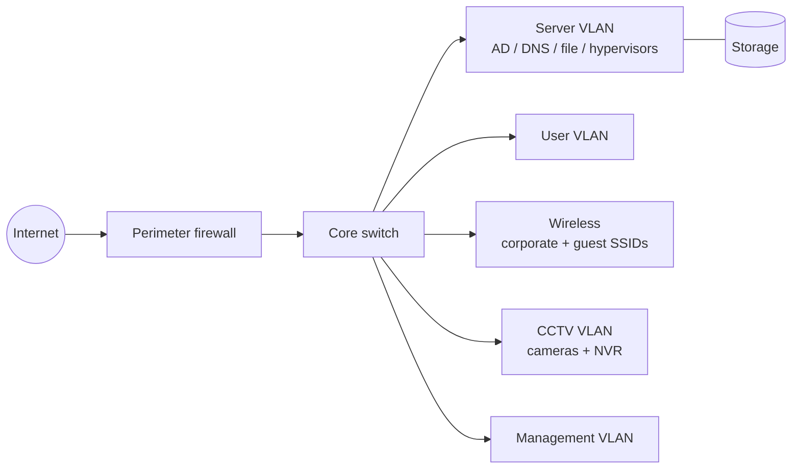

# Enterprise Data Center & Office Infrastructure — Security by Design

**Type:** Professional case study (sanitized) &nbsp;·&nbsp; **Environment:** Corporate office and server room
**Confidentiality:** Client, site, device names, addressing and configurations are intentionally omitted. Diagrams and tables below are generic and redrawn from scratch.

## Context

A new office and server room needed a complete infrastructure build: network switching, perimeter firewall, servers and storage, wireless, directory and file services, and CCTV. Projects like this involve many vendors and layers at once, and security gaps usually appear at the boundaries between them — shared admin passwords, flat networks, undocumented ownership, and backups nobody has tested.

## My role

- Contributed to the deployment across network switching, firewalling, server infrastructure, storage, wireless networking and CCTV.
- Supported technical documentation and the infrastructure handover across these components.

## Generic architecture

## Security considerations applied across the layers

| Layer | Risk if done badly | Practice |
|---|---|---|
| Network | Flat network lets any device reach servers and cameras | Separate VLANs for servers, users, guests, CCTV and management; inter-VLAN traffic controlled at the firewall |
| Firewall | Broad "allow all" rules added to get things working | Least-privilege rules, logging enabled, admin access only from the management network |
| Wireless | Guests on the corporate network | Separate guest SSID mapped to an isolated VLAN with internet-only access |
| Servers / AD | Shared admin accounts, no audit trail | Named admin accounts, role-based groups, GPO baseline (see [case study 03](../03-active-directory-hardening/)) |
| Storage / backup | Backups on the same storage as production; never tested | Separate backup target, documented restore test |
| CCTV | Default passwords, cameras reaching the internet | Changed default credentials, CCTV VLAN with no internet, NVR reachable only by authorised users |
| Handover | Nobody knows who owns what | Asset list, credential hand-over through a secure channel, documented ownership (see [case study 04](../04-enterprise-network-handover/)) |

## Example VLAN and access matrix (fictional)

| VLAN | Purpose | Can reach | Cannot reach |
|---|---|---|---|
| Management | Device administration | All device management interfaces | — |
| Servers | AD, DNS, file, virtualization | Required replies, updates | User devices (except replies), CCTV |
| Users | Staff PCs | AD/DNS/file services, internet (filtered) | Management, CCTV |
| Guest | Visitor Wi-Fi | Internet only | Everything internal |
| CCTV | Cameras, NVR | NVR only | Internet, users, servers |

## Takeaways

- Security has to be planned into the VLAN and firewall design at the start; retrofitting segmentation after go-live means downtime.
- Low-voltage systems (CCTV, AV, building systems) are network devices and need the same credential and segmentation discipline as servers.
- Documentation is a security control: an accurate asset list and access matrix is what makes later audits and incident response possible.

## Related labs

- [Firewall policy auditor](../05-firewall-policy-auditor/) · [Hotel segmentation reference design](../08-hospitality-network-segmentation/) · [IOS hardening checker](../09-cisco-config-hardening-checker/)
