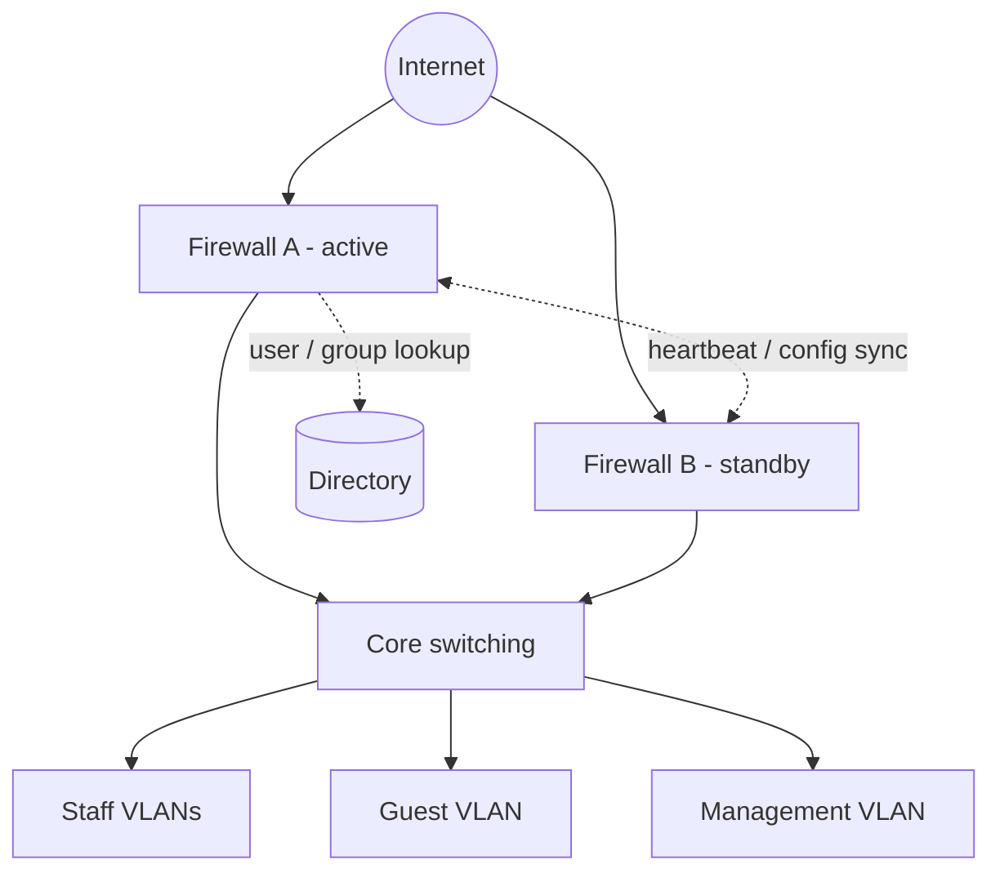

# Firewall High Availability & Identity-Based Access Control

**Type:** Professional case study (sanitized) &nbsp;·&nbsp; **Environment:** Hospitality
**Confidentiality:** No property name, addressing, rule exports or credentials are included. The policy matrix and diagram below are illustrative, not copies of production configuration.

## Context

A hotel needed a resilient perimeter and different internet access levels for different staff roles. The deployment combined a high-availability firewall pair, security policies, integration with the directory so policies apply to users and groups rather than IP addresses, and role-based web/application controls.

## My role

- Worked on the deployment involving the HA firewall pair, security policies, directory integration and role-based internet access controls.
- Documented access-policy behaviour and supported functional testing of network access.

## Design (conceptual)

**Why identity-based policy:** staff move between desks and devices, and DHCP addresses change. Tying policy to AD groups means a user gets the same access wherever they log in, and a leaver loses access when their account is disabled.

## Illustrative policy matrix

| Source group | Destination | Control |
|---|---|---|
| Standard staff | Approved business services | Allow required services; web filtering applied |
| Restricted staff | General internet | Deny selected categories per approved policy |
| IT administrators | Device management interfaces | Allow only from the management network |
| Guest devices | Internal networks | Deny by default; internet only |
| Any | Anything not listed | Deny and log |

## Rule hygiene standard

Every rule should record: purpose, source, destination, service, owner, change reference and review date. Temporary rules get an expiry schedule. Admin interfaces are never reachable from WAN. (These checks are automated in the [firewall policy auditor](../05-firewall-policy-auditor/).)

## Functional test approach

| Test | Expected result |
|---|---|
| User in "standard" group browses an allowed business site | Allowed, logged |
| User in "restricted" group opens a blocked category | Block page shown, logged with username |
| Same user logs in on a different PC | Same policy follows the user |
| Guest device attempts to reach an internal address | Denied |
| Admin GUI from a non-management VLAN | Denied |
| Active unit failover (approved maintenance window) | Traffic continues on standby unit; sessions recover |

## Takeaways

- HA protects availability, not security: both units share the same rulebase, so a bad rule is replicated instantly — change control still matters.
- User-based policy is only as reliable as the identity source; directory health and agent/collector monitoring become part of the firewall's dependencies.
- Testing should be written down as expected vs actual results so the client can sign it off.
