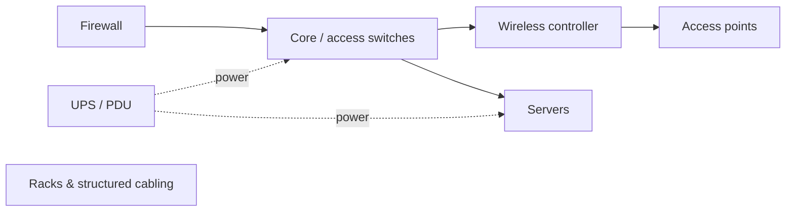

# Enterprise Network Infrastructure Handover — Security Checklist

**Type:** Professional case study (sanitized) &nbsp;·&nbsp; **Environment:** Enterprise network and security infrastructure
**Confidentiality:** No bills of materials, serial numbers, management addresses, inventories or diagrams from the real project are included. The checklist and tables are generic templates.

## Context

At the end of a deployment the infrastructure moves from the project team to the people who will run it. If the handover is weak, the client inherits unknown passwords, undocumented rules and devices nobody monitors — which become the security problems of the next few years.

## My role

- Supported the handover of enterprise network and security infrastructure, including firewall, switching, wireless access, server, UPS, rack and cabling components.

## Scope (generic)

## Security-focused handover checklist

**Inventory and ownership**
- [ ] Asset register: model, role, location, firmware, warranty/support status
- [ ] Owner named for each system; escalation contacts agreed

**Access and credentials**
- [ ] Default and project credentials changed before handover
- [ ] Credentials transferred through an approved secure method (password manager / sealed process — never e-mail or spreadsheets)
- [ ] Named admin accounts; shared accounts removed or vaulted as break-glass
- [ ] Management access restricted to the management network

**Configuration**
- [ ] Final configurations backed up to an approved, access-controlled location
- [ ] Firmware versions recorded and checked against vendor advisories
- [ ] Licences and subscriptions (IPS, web filter, support) active and documented

**Validation**
- [ ] VLANs, routing, DNS, DHCP and wireless tested as applicable
- [ ] Firewall rules reviewed — no temporary or "any/any" commissioning rules left
- [ ] UPS runtime and shutdown behaviour verified
- [ ] Logging and monitoring sending to the agreed destination; alert recipients confirmed

**Closure**
- [ ] Backup, recovery and escalation procedures documented
- [ ] Open issues, exclusions and accepted risks recorded
- [ ] Client acceptance signed

## Example acceptance table (fictional)

| Item | Test | Expected | Result |
|---|---|---|---|
| Guest Wi-Fi isolation | Guest client pings internal gateway | No reply | Pass / Fail |
| Admin access | SSH to switch from user VLAN | Refused | Pass / Fail |
| Firewall failover | Disconnect active unit (approved window) | Traffic continues | Pass / Fail |
| UPS | Simulate mains loss | Runtime ≥ agreed minutes; alert sent | Pass / Fail |
| Logging | Generate a denied connection | Event visible on log server | Pass / Fail |

## Takeaways

- Commissioning shortcuts (temporary rules, default passwords, Telnet left on for convenience) are the most common leftovers — the handover is the last chance to remove them.
- Credential handover needs a defined secure channel; it is often the weakest point of the whole project.
- An honest list of open issues and accepted risks protects both the client and the integrator.

## Related labs

- [IOS hardening checker](../09-cisco-config-hardening-checker/) and [firewall policy auditor](../05-firewall-policy-auditor/) automate several of the checklist items above.
