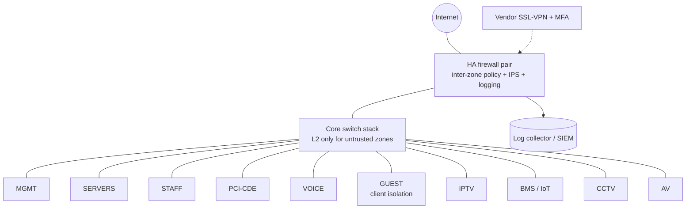

# Hotel Network Segmentation — Reference Design

**Type:** Design exercise (reference architecture) &nbsp;·&nbsp; **Status:** Complete design; lab validation of the policy matrix planned
**Note:** This is a generic design written from scratch. It is not the network of any real property. All names and addresses are fictional.

## Problem

A hotel network carries very different kinds of traffic on the same physical infrastructure: card payments, the property management system, guest Wi-Fi from thousands of untrusted devices, room controls, IPTV, CCTV, voice, and vendors who need remote access. A flat network means one infected guest laptop or one compromised IoT controller can reach the payment systems. The goals of this design are:

1. Keep payment systems in a small, well-defined zone (reduces PCI DSS scope).
2. Isolate guests from everything internal and from each other.
3. Treat IoT / building systems as untrusted and give them only the flows they need.
4. Make management of network devices reachable only from a dedicated management zone.
5. Give vendors time-limited, MFA-protected access to exactly the systems they support.

## Zones and VLAN plan (fictional addressing)

| VLAN | Zone | Example contents | Subnet | Trust |
|---|---|---|---|---|
| 10 | MGMT | Switch / AP / firewall / UPS management, jump host | 10.50.10.0/24 | High — admins only |
| 20 | SERVERS | Directory, file, PMS application, backup | 10.50.20.0/24 | High |
| 30 | STAFF | Back-office PCs, front desk | 10.50.30.0/23 | Medium |
| 40 | PCI-CDE | POS terminals, payment servers | 10.50.40.0/25 | Restricted — PCI scope |
| 50 | VOICE | IP phones, call server | 10.50.50.0/24 | Medium |
| 60 | GUEST | Guest Wi-Fi and wired room ports | 100.64.0.0/20 (CGNAT range) | Untrusted |
| 70 | IPTV | TV headends and set-top boxes | 10.50.70.0/23 | Low |
| 80 | BMS-IOT | Room controls (GRMS), HVAC, lighting, door locks | 10.50.80.0/23 | Low |
| 90 | CCTV | Cameras and NVRs | 10.50.90.0/23 | Low |
| 95 | AV | Meeting-room displays, conferencing | 10.50.95.0/24 | Low |
| 99 | VENDOR-VPN | VPN address pool for third parties | 10.50.99.0/26 | Untrusted until authenticated |

## Architecture

**Key decision:** routing between zones happens on the firewall, not on the core switch. Switch SVIs exist only for management. This costs some firewall throughput but means every inter-zone flow is subject to policy, inspection and logging. High-volume, low-risk flows (e.g. IPTV multicast) stay inside their own VLAN and never need to cross the firewall.

## Inter-zone policy matrix

Default for every pair is **deny + log**. Only the flows below are allowed.

| From ↓ / To → | MGMT | SERVERS | STAFF | PCI-CDE | GUEST | IoT / CCTV / AV | Internet |
|---|---|---|---|---|---|---|---|
| **MGMT** | — | Admin protocols (SSH, RDP, HTTPS) | Admin (SSH, RDP, HTTPS) | Admin (logged, named accounts) | Device mgmt only | Device mgmt only | Updates via proxy |
| **SERVERS** | Syslog / SNMPv3 traps | — | Required app replies | PMS ↔ payment interface (defined ports) | ✗ | Integrations (e.g. PMS → room controls, specific ports) | Updates, cloud backup |
| **STAFF** | ✗ | AD, DNS, file, PMS client | — | ✗ | ✗ | ✗ | Web via filtering |
| **PCI-CDE** | ✗ | Payment interface only | ✗ | — | ✗ | ✗ | Payment processor only (FQDN-based) |
| **GUEST** | ✗ | ✗ | ✗ | ✗ | ✗ (client isolation) | Casting to own room TV only, via controller | Web via filtering, rate-limited |
| **IoT / CCTV / AV** | ✗ | Specific controller / NVR flows | ✗ | ✗ | ✗ | — | Vendor cloud only if required (FQDN allow-list) |
| **VENDOR-VPN** | ✗ | Named server + port, during approved window | ✗ | Only with PCI-approved process | ✗ | Named controller + port | ✗ |

## Control details

**PCI DSS scope reduction**
- Only devices that store, process or transmit card data live in PCI-CDE; anything that can reach them is "connected-to" and also in scope, which is why STAFF has no path to PCI-CDE.
- Outbound from PCI-CDE limited to the payment processor's FQDNs.
- Segmentation must be **tested**: PCI DSS v4.0 requirement 11.4.5 requires penetration testing of segmentation controls at least every 12 months and after changes (every 6 months for service providers).

**Guest network**
- Captive portal; AP-level and switch-level client isolation (private VLAN / port isolation).
- Guest DNS goes to a filtering resolver; no internal DNS reachable.
- Per-device bandwidth limits; separate SSID and VLAN for events/conference attendees.

**IoT / building systems / CCTV**
- No internet unless the vendor needs it, then FQDN allow-listing only.
- NVRs reachable only from the security office's workstations and the MGMT zone.
- Default credentials changed at commissioning and stored in the password vault.

**Management plane**
- Device management interfaces bound to VLAN 10 only; SSH v2 / HTTPS; no Telnet / HTTP.
- Admin access via jump host with MFA; TACACS+/RADIUS with named accounts; local break-glass account vaulted.
- Config backups stored encrypted, not on shared drives.

**Vendor access**
- SSL-VPN with MFA, per-vendor groups, access limited to named hosts and ports.
- Access enabled for an approved window (one-time schedule), sessions logged; disabled by default.

**Logging**
- All deny events and all inter-zone allows logged to the collector; alert on any traffic from GUEST or IoT to internal zones (should never happen).

## Validation plan (for the lab build)

| # | Test | Expected |
|---|---|---|
| 1 | Guest client → another guest client (ping, SMB) | Blocked |
| 2 | Guest client → any 10.50.0.0/16 address | Blocked, logged |
| 3 | Staff PC → POS terminal | Blocked |
| 4 | POS → arbitrary internet site | Blocked; payment processor FQDN allowed |
| 5 | IoT controller → server zone, non-approved port | Blocked |
| 6 | Staff PC → switch management IP | Blocked; from jump host allowed |
| 7 | Vendor VPN outside approved window | Login denied |
| 8 | nmap sweep from each zone to every other zone | Only matrix flows open |

## Trade-offs

- **Firewall-routed inter-VLAN** gives visibility but needs a firewall sized for east-west traffic.
- **Many VLANs** increase operational effort; mitigated with consistent numbering and templates across properties.
- **CGNAT range for guests** avoids any overlap with internal private ranges and makes guest traffic easy to spot in logs.

## Skills demonstrated

Network segmentation · PCI DSS scoping · zero-trust style policy design · wireless guest isolation · IoT/OT risk handling · secure management plane · test planning
